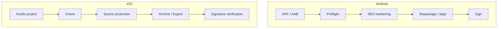

<div align="center">
  
  <h1>Shellsmith</h1>
  <p><strong>Android and iOS App Hardening</strong></p>
  <p>Offline &amp; online keys · Android &amp; iOS hardening · Integrated signing</p>
  <p><a href="README.md">简体中文</a> | English</p>
  <p>
    <a href="https://github.com/kairowan/Shellsmith/releases/latest"></a>
    <a href="https://github.com/kairowan/Shellsmith/actions/workflows/ci.yml"></a>
    <a href="#license"></a>
  </p>
</div>

Shellsmith is a desktop hardening tool for Android and iOS apps, with two key-delivery modes: **local offline keys** and **self-hosted online keys**. In offline mode, key derivation, hardening, signing, and artifact verification all happen on your machine, with no network or key service required. In online mode (BYOS), the artifact IKM is held by your self-hosted HTTPS service; the APK carries only the service URL and token and fetches the key at launch after device approval or Google Play Integrity authorization.

On Android, Shellsmith provides DEX encryption and certificate binding for APK/AAB, PVM2 method virtualization, baseline anti-debugging, and optional strict protection, then repackages, aligns, and signs the output. On iOS, it works on an isolated copy, integrates Swift Confidential and freeRASP, then archives, exports, and verifies signing. Apart from registration and key fetch against your own service in online mode, APKs, certificates, signing materials, and passwords are never uploaded or sent to Shellsmith maintainers.

A desktop GUI is available for Windows, macOS, and Linux, with Chinese and English interfaces. The CLI is built from source for automation.

> Use only with applications you own or are authorized to protect. Do not bypass third-party protections or use this tool for unauthorized purposes.

**Quick navigation** · [Capabilities](#core-capabilities) · [Quick Start](#quick-start) · [Compatibility](#compatibility-and-limitations) · [Online Keys (BYOS)](#byos-out-of-package-keys) · [Security Scope](#how-it-works-and-security-scope) · [Documentation](#documentation-and-development)

## Core Capabilities

- **Two key-delivery modes:** **Offline keys** are derived locally and wrapped into the artifact, requiring no network or key service. **Online keys (BYOS)** keep the IKM on your self-hosted HTTPS service; the artifact carries only the service URL and token and fetches the key at launch after device approval or Play Integrity authorization. See [BYOS Out-of-Package Keys](#byos-out-of-package-keys).
- **Android code protection:** encrypt application DEX files, bind them to the original certificate, and support PVM2 method virtualization, baseline anti-debugging, and optional strict protection; then repackage, align, and sign.
- **iOS source protection:** modify an isolated working copy with Swift Confidential and freeRASP, then archive, export, and verify it with `xcodebuild`. The original project is left unchanged.
- **Integrated signing:** import, create, and manage certificates; sign protected output automatically or sign an APK independently.
- **Preflight checks and diagnostics:** inspect signatures, existing protection, system requirements, and ABIs; on failure, show a sanitized summary that can be previewed before submission.
- **Reusable settings:** remember protection options and the certificate choice, customize output directory and filename, and freeze each task's configuration.
- **Installation compatibility:** handle APK ZIP alignment and common native-library cases, with separate standard and Android 4.4 industrial modes.

Both pipelines raise the cost of static analysis, tampering, and unauthorized re-signing. They do not guarantee that an app cannot be unpacked or reverse engineered.

## Quick Start

### Download

Download a stable desktop installer from [GitHub Releases](https://github.com/kairowan/Shellsmith/releases/latest):

| Platform | Package |
|---|---|
| Windows | `Shellsmith_x.y.z_windows_x64_setup.exe` |
| macOS | `Shellsmith_x.y.z_macos_universal.dmg` |
| Linux | `Shellsmith_x.y.z_linux_amd64.AppImage` or `.deb` |

### Requirements

- A **full JDK 8 or later**, with `java` and `keytool` available; PVM2 requires Java 17+.
- Desktop release users do not need to install the Android SDK. apktool, apksigner, bundletool, and aapt2 are bundled.
- iOS hardening requires macOS with full Xcode; Windows and Linux cannot archive or export an IPA.

Signing status depends on how the package was produced:

- Local source builds are ad-hoc signed.
- External macOS releases are signed and notarized only when Developer ID and a notary profile are configured, and their artifact name carries the `_notarized` suffix. Run packages without that suffix only from a trusted source.

### Android Quick Start

1. In **Certificates**, import the original APK's signing certificate. For a new project, you may create one, but the input APK must also be signed with it first.
2. In **Protect**, select an already signed APK, or switch to **AAB · Google Play** and select a signed AAB, then review the preflight results.
3. Choose the target system and protection policy. Normally use Android 5.0+ and the recommended standard protection; use industrial mode only when Android 4.4 is required.
4. Review the output directory, filename, automatic signing certificate, and per-app sharing choice, then start protection.
5. Test the signed output on target devices: installation, launch, core functionality, and upgrade installation.

### iOS Quick Start

Install full Xcode on macOS, open **Protect → iOS**, select an `.xcodeproj` or `.xcworkspace`, enter the scheme, Team ID, and Bundle ID, run the check, and choose a separate empty output directory. `confidential.yml`, the freeRASP watcher email, and the App Attest server endpoint are all optional. Strict client hardening works without an endpoint, but it does not include a server-side device-attestation loop.

### Output and Signing

Output defaults to the input APK's directory with a suggested filename; both can be changed before execution. Without automatic signing, sign the output with the original certificate.

**Re-signing protected output with another certificate prevents startup.**

<details>
<summary>macOS reports that the developer cannot be verified</summary>

After verifying the download source and moving the application to `/Applications`, you can run:

```bash
xattr -rd com.apple.quarantine /Applications/Shellsmith.app
```

This removes quarantine; it does not mean the application is notarized by Apple. Open it again. See the [usage guide](docs/usage.md) for more help.

</details>

## Preview

<p align="center">
  
</p>

The screenshot illustrates the layout; available options depend on the current version. More screens and instructions are in the [usage guide](docs/usage.md).

## Compatibility and Limitations

### Scope

| Mode | Scope |
|---|---|
| Android 5.0 and later | API 21+; `armeabi-v7a`, `arm64-v8a`, `x86`, and `x86_64`. An APK does not need all four ABIs |
| Android 4.4 industrial | API 19+; inputs must have no native libraries or only `armeabi-v7a` libraries. Physical-device coverage is an Android 4.4.2 `armeabi-v7a`/NEON industrial device |
| iOS source project | iOS 13+ SwiftUI/UIKit application targets; archive, export, and signing require macOS with full Xcode |
| Online keys (BYOS) | Android APK only; `device_approval` requires `minSdk 24+`, `play_integrity` requires `minSdk 29+`; requires a reachable self-hosted HTTPS service and network; AAB, iOS, and Android 4.4 compatibility mode are not supported |

### Not Supported

- Protected APKs/AABs cannot be protected again.
- iOS requires source and legitimate signing access. Shellsmith does not inject into arbitrary IPAs, bypass signatures, or repackage third-party apps.
- Compatibility mode does not lower the application's `minSdkVersion`.
- Missing business libraries are not generated.
- The GUI processes one APK or AAB at a time; no batch queue is provided.
- Swift Confidential only processes Swift source. Objective-C projects can use RASP but get no literal protection, so do not supply `confidential.yml` for them.
- Online keys (BYOS) support Android APKs only. Without a reachable self-hosted HTTPS service and network, a BYOS artifact cannot start and does not fall back to offline loading.

### Requires Your Own Validation

- Vendor systems and hardware still need testing; a successful build does not establish compatibility with every environment.
- Google Play App Signing, dynamic features, Asset Packs, and dynamic delivery still require validation in the target app's internal test track.
- Unneeded legacy ABIs can be excluded with per-task confirmation, but prefer filtering them in the original project.
- 16 KB ZIP alignment does not establish ELF page-size compatibility for every third-party library or guarantee Google Play acceptance.

### Known Issues

- Linux startup applies a WebKitGTK DMABUF compatibility setting for Fedora AppImage issue [#121](https://github.com/kairowan/Shellsmith/issues/121); the reporter's release environment still requires validation.

See the [usage guide](docs/usage.md) for detailed boundaries.

## BYOS Out-of-Package Keys

Shellsmith offers two key-delivery modes:

| Mode | Key location | Runtime requirement | Use case |
|---|---|---|---|
| Local offline key | Derived on the build machine and wrapped into the APK | No network or key service | Fully offline delivery, no backend |
| Online key (BYOS) | Your self-hosted HTTPS service | Network authorization on every launch | Device approval, Play Integrity, device/artifact revocation |

Local offline keys are the default. To move the IKM out of the APK, select a BYOS service under **Key Delivery**. Choose the mode per protection task; online mode never falls back to offline keys when authorization fails. The rest of this section covers the online key mode.

BYOS (Bring Your Own Server) moves the artifact IKM out of the APK. It is intended for teams that manage their own keys, device authorization, and revocation policy.

During protection, Shellsmith generates an independent 32-byte IKM for each artifact and registers it with your self-hosted service in exchange for a `token_id`. The APK carries only the service URL and token. At launch, the client generates an ephemeral RSA key pair and requests the IKM with the token plus a device proof or Play Integrity proof. After validating authorization, replay protection, and the device or Play result, the server encrypts `digest[32] || IKM[32]` to the request's RSA public key and returns it. The client decrypts and verifies the digest before loading business code.

### Authorization Modes

| Mode | Use case | Requirements |
|---|---|---|
| `device_approval` | Domestic distribution, sideloading, private channels | Device EC P-256 public-key registration and administrator approval; Android 7.0+ (`minSdk 24`) |
| `play_integrity` | Google Play distribution | Play Console and a Google Cloud service account; Android 10+ (`minSdk 29`) |

Neither mode falls back to offline loading on failure. An unknown device is recorded as pending and denied; a failed Play check never switches to device approval.

### Workflow

1. Deploy the self-hosted HTTPS service, create an application policy, and create a build API key. Source builds must generate the device-approval and Play resources separately with `make build-byos` and `make build-byos-play`; release packages include the matching resources.
2. In Shellsmith, open **Key Delivery → Add Service** and fill in the HTTPS base URL, build API key, authorization mode, and final certificate SHA-256.
3. Test the connection, then protect and sign the APK. Each artifact receives a new `token_id`.
4. In device mode, the first launch is denied until an administrator approves the device; in Play mode, validate with a Play test-track APK.
5. Revoking a device or artifact blocks future fetches. IKM and plaintext code already loaded into a running process cannot be recalled remotely.

### Security Boundaries

- BYOS keeps the IKM out of the APK and reduces offline key recovery from the package. It is not DRM and cannot prevent memory extraction, hooking, or further analysis of an authorized process.
- The server is the trust root. If the server, KMS, or HSM is compromised, an attacker can unseal the IKM. Protect the database, master keys, KMS/HSM permissions, and backups as described in the server documentation.
- The key is still fetched on every launch, including cache-based launches; there is no offline fallback when the network or service is unavailable. Revocation affects only future fetches.
- The build API key is only for protection-time registration. It is not included in the APK and does not grant runtime authorization.
- AAB, iOS, and Android 4.4 compatibility mode do not support BYOS.

Shellsmith does not host the BYOS service. The repository documents a separately deployable Go/PostgreSQL reference implementation with device approval, Play Integrity, replay protection, auditing, master-key rotation, and `migrate-backend`, supporting local `local_aead`, AWS KMS, GCP KMS (including Cloud HSM), and PKCS#11 HSM:

- [BYOS HTTPS Key Service Protocol](docs/design/byos-key-server.md)
- [Server Reference and Deployment](docs/design/byos-key-server-reference.md)
- [BYOS Local Validation and Troubleshooting](docs/process/byos-local-validation.md)
- [DEXB boundaries in the technical internals](docs/design/internals.md)

## How It Works and Security Scope



### Android

Protection reads the original certificate, compresses and encrypts DEX files, injects the stub, then rebuilds, aligns, and optionally signs the APK. At runtime, the stub checks the environment, validates or decrypts the DEX cache, loads code, and starts the original application.

With local offline keys, DEXB v6 payload encryption **does not provide confidentiality against static analysis**: both inputs of the envelope key (the signing certificate fingerprint and the build ID) are stored in cleartext in the package header, so the key can be recovered from the APK file alone, and with it the derived keys for every business DEX, the PVM2 images, encrypted assets and business `.text`. What it does provide is refusal to run after re-signing, plus a higher cost for automated scanning and reverse engineering.

Online-key (BYOS) artifacts use DEXB v7: the APK header stores only `server_url` and `token_id`; the IKM remains on the server and is released after authorization, so the APK alone cannot recover it. An authorized process still holds the IKM and plaintext code in memory.

Production uses a decrypted DEX cache in the application's private directory. It is **not a fully in-memory DEX loader or method-code extraction scheme**. Root access, process control, or other elevated privileges may allow runtime code extraction. Standard protection does not block startup solely because of root signals; strict protection blocks some risky environments but cannot guarantee detection of hidden root or prevent bypasses.

### iOS

The iOS pipeline edits only a working copy, resolves exact upstream Swift Package versions, generates a stable threat-event wrapper, uses Apple's native Archive/Export flow, and verifies signatures, Team ID, Bundle ID, entitlements, arm64, privacy manifests, dSYMs, and selected sensitive literals. Closed-source freeRASP behavior and the known RootHide gap remain upstream residual risks.

Hardening does not replace server-side authorization, key management, or application security design. See [runtime security](docs/design/runtime-security.md), [technical internals](docs/design/internals.md), and [iOS hardening](docs/design/ios-hardening.md).

## Privacy

In local offline-key mode, APKs, certificates, keystores, and signing passwords are processed locally and not uploaded. When BYOS is explicitly enabled, the artifact IKM and build credential are sent only to the self-hosted HTTPS service you configure, not to Shellsmith maintainers. The desktop tool also has the following independent data channels:

| Channel | Data and controls |
|---|---|
| Safe error reports | Preview and confirm each report; no raw logs, APKs, paths, package names, certificates, or passwords. Independent of the other channels |
| Per-app usage sharing | Controlled on protection/signing pages, selected by default for new package names. Opt-outs persist across pages and restarts. Successful operations send app name, package name, version code, tool version, operation, flow, success date, and protocol/deduplication metadata; no device identifier |
| BYOS out-of-package keys | Enabled only by an explicit protection setting. Sends the build credential and artifact IKM to the HTTPS service you provide for registration and key fetch; the data is controlled by your service |

App sharing is maintainer-only and retained for 180 days. Opting out stops future sharing for that package but does not delete received records. **These reporting features are not injected into protected APKs.** See [data and privacy documentation](docs/ops/telemetry.md) for scope, retention, and deletion details.

In-app problem feedback never reports automatically: the feedback text (for bug reports, together with the automatically attached version, OS, Java, and tool-status diagnostics) is sent to a public GitHub issue only after the user fills in the form, previews it, and confirms sending. If the service is unavailable, the app offers to open a prefilled issue page in the browser instead.

The iOS balanced and strict profiles integrate freeRASP directly into the target app. Its `watcherMail`, security events, and network behavior are governed by Talsec's terms and privacy policy and require app-owner disclosure before release. Shellsmith does not host the freeRASP binary.

## Feedback and Community

- Read the [support guide](docs/process/support.md), then open a [GitHub issue](https://github.com/kairowan/Shellsmith/issues); you can also submit directly from the **Problem feedback** section on the Settings page.
- For feature requests, choose **Feature request** in the **Problem feedback** section, or use the [feature request form](https://github.com/kairowan/Shellsmith/issues/new?template=feature_request.yml); upvote an existing matching request instead of filing a duplicate.
- Report vulnerabilities privately following [SECURITY.md](SECURITY.md). Do not publish exploits, business APKs, certificates, or passwords.

## Documentation and Development

| Topic | Documentation |
|---|---|
| GUI, certificates, configuration locations, and CLI | [Usage guide](docs/usage.md) |
| Installation and runtime problems | [Troubleshooting](docs/ops/troubleshooting.md) |
| Source builds | [Build guide](docs/ops/build.md), [environment requirements](docs/ops/environment.md) |
| Architecture and internals | [Documentation index](docs/README.md) |
| iOS integration, configuration, and security scope | [iOS hardening](docs/design/ios-hardening.md) |
| BYOS protocol, error codes, and test vectors | [BYOS HTTPS Key Service](docs/design/byos-key-server.md) |
| BYOS server deployment, KMS/HSM, and operations | [Server reference](docs/design/byos-key-server-reference.md) |
| BYOS local validation and real-device troubleshooting | [Local validation](docs/process/byos-local-validation.md) |
| Future work | [Roadmap](docs/process/roadmap.md) |

The CLI is source-built; Releases contain desktop GUI packages only. Build `make build-stub` first, then `make build-cli` or `make build-gui`. Refer to the build guide for dependencies and platform-specific steps.

<details>
<summary>CI/CD and Cross-Platform Releases</summary>

GitHub Actions live under `.github/workflows/`:

- Every push to `main` and every pull request runs Rust, Python, iOS-core, and frontend checks.
- The `Release` workflow is **manual only**: run `workflow_dispatch` on a `main` commit and enter a version matching `package.json`. The workflow validates the source and version, builds native Linux, macOS, and Windows installers, and creates a GitHub Release. Merging a normal pull request does not trigger a release.
- The release job uploads Linux `.AppImage`/`.deb`, macOS `.dmg`, Windows `.exe`, Android runtime resources, and SHA-256 checksum files, and generates the update manifest.
- macOS builds use ad-hoc signing by default. Set `MACOS_RELEASE_MODE=developer-id`, a Developer ID identity, and a notarytool profile to produce a distributable notarized package.

The same scripts can be used locally, reading the version from `package.json`:

```bash
VERSION=$(node -p "require('./apps/shield-gui/package.json').version")
VERSION="$VERSION" ./scripts/release-linux.sh
VERSION="$VERSION" ./scripts/release-macos.sh "$VERSION" universal
```

On Windows, run this from an elevated PowerShell:

```powershell
$version = (Get-Content apps/shield-gui/package.json | ConvertFrom-Json).version
.\scripts/release-windows.ps1 -Version $version
```

All three builds include the stub, PVM2 packer, Android resources, and signing tools; install and verify each package on its target OS before publishing.

</details>

## Acknowledgements

Shellsmith's hardening capabilities build on the upstream projects and tools below. Licenses and third-party notices for redistributed components ship in `tools/licenses/`.

<details>
<summary>Upstream projects and tools</summary>

### Origin project

| Project | License | Notes |
|---|---|---|
| [Mocika Shield](https://github.com/mocikadev/mocika-shield) | MIT OR Apache-2.0 | The origin of this project. DEX encryption, stub loading, signature binding, baseline runtime protection, and certificate/signing management all evolved from it; Shellsmith extends it with iOS hardening, AAB handling, Native VMP, and in-app updates. |

### Code protection

| Project | License | Use |
|---|---|---|
| [XopProtector](https://github.com/xopJack/XopProtector) | Apache-2.0 | PVM2 and True-VMP code protection; the runtime and packer sources are redistributed in `third_party/xopprotector/`, and `xop-pvm2-packer.jar` ships with releases |
| [LLVM](https://llvm.org/) | Apache-2.0 WITH LLVM-exception | Native VMP is implemented as an LLVM 21 pass plugin for the app's native build (`native-vmp/`; standalone component, not yet wired into the hardening flow) |

### iOS runtime protection

| Project | License | Use |
|---|---|---|
| [freeRASP](https://github.com/talsec/Free-RASP-iOS) 7.1.4 | MIT, subject to Talsec's fair usage policy | iOS runtime threat detection; resolved on the user's machine, no binary redistribution |
| [Swift Confidential](https://github.com/securevale/swift-confidential) 0.5.2 | Apache-2.0 | Swift sensitive literal protection (optional) |

### Packaging, signing, and build tools

| Project | License | Use |
|---|---|---|
| [Apktool](https://apktool.org/) 3.0.3 | Apache-2.0 | APK decoding and rebuilding; redistributed with releases |
| [apksigner](https://developer.android.com/tools/apksigner) (Android SDK Build-Tools) | Apache-2.0 | APK signing and signature verification; redistributed with releases |
| [bundletool](https://github.com/google/bundletool) · [aapt2](https://developer.android.com/tools) | Apache-2.0 | AAB module handling and resource compilation |
| [Android NDK](https://developer.android.com/ndk) | Apache-2.0 | Compiling the stub native libraries and Android 4.4 compatibility libraries |

Desktop frameworks, frontend packages, and general-purpose Rust libraries are not enumerated here; exact versions and licenses can be reproduced from `Cargo.lock`, `apps/shield-gui/package-lock.json`, and `shield-stub/gradle/libs.versions.toml`.

</details>

If a credit is wrong, a license is mislabeled, or a project is missing, please open an issue or pull request and we will correct it.

## License

Dual-licensed under **MIT OR Apache-2.0**, at your choice: [MIT](LICENSE-MIT) · [Apache-2.0](LICENSE-APACHE).
