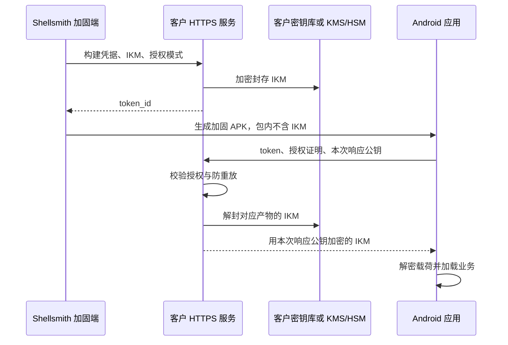

# BYOS HTTPS 密钥服务接入协议

本文供实现密钥服务的后端开发者和部署人员使用。BYOS 指由使用方提供并管理自己的 HTTPS 密钥服务；Shellsmith 负责加固时注册产物密钥，以及 Android 应用启动时请求密钥。

**协议版本：** APK 载荷采用 DEXB v7，取钥协议字段为 `fetch_protocol: 2`。接口路径中的 `/v1` 与取钥协议号是两个不同标识，必须按本文分别填写。

**适用范围：** Android APK；设备授权要求输入应用的 `minSdkVersion >= 26`（Android 8.0），Google Play Integrity 授权要求 `minSdkVersion >= 29`（Android 10）。支持桌面 GUI 和 CLI `protect`。AAB、iOS、Android 4.4 兼容运行时不支持此接入方式。默认离线加固无需密钥服务。

**服务端参考实现：** 需要可直接部署的 Go/PostgreSQL 参考实现、KMS/HSM 适配、管理员命令和部署验收步骤时，见 [BYOS 密钥服务端参考实现](byos-key-server-reference.md)。

阅读顺序：

1. [了解流程与职责](#流程与职责)
2. [准备配置与密钥存储](#接入前准备)
3. [实现三个 HTTPS 接口](#接口规范)
4. [接入桌面端并生成 APK](#桌面端与命令行接入)
5. [完成部署验收](#部署验收)

## 流程与职责

加固时，Shellsmith 为每个产物独立生成 32 字节密钥材料，本文称为 **IKM**。服务端加密保存 IKM 并返回 `token_id`；APK 只携带服务地址和 token 等公开信息。应用启动时，服务端先验证授权，再加密返回这个产物原来的 IKM。



| 参与方 | 负责的内容 |
|---|---|
| Shellsmith | 生成 IKM、调用注册接口、生成加固 APK；提供桌面连接测试和 Android 取钥客户端 |
| 使用方的 HTTPS 服务 | 实现检查、注册、取钥接口；管理构建凭据、应用策略、设备授权、密钥存储、吊销和防重放 |
| 使用方的密钥后端 | 使用自有随机主密钥、KMS 或 HSM 保管 IKM，提供封存和解封能力 |

Shellsmith 不提供托管服务器，也没有内置各厂商 KMS/HSM 驱动。使用方需在自己的服务端适配所选密钥后端，手机端统一使用本文的取钥协议。

## 接入前准备

### 选择授权方式

| 授权方式 | 适用场景 | 服务端必须具备 |
|---|---|---|
| `device_approval` | 国内、海外侧载或自有分发渠道 | 设备公钥登记、批准与撤销能力；无需 Google/HMS 配置 |
| `play_integrity` | Google Play 分发 | Play Console 关联应用、Google 服务身份、Integrity 校验和发布策略 |

在 GUI 或 CLI 显式选择授权方式。每个 token 固定一种方式；不同方式分别生成产物。Play 校验失败不切换到设备授权，BYOS 取钥失败也不回退为离线加载。

### 准备应用配置

| 信息 | 配置位置 | 要求 |
|---|---|---|
| HTTPS 基础地址 | 服务端与 Shellsmith | 例如 `https://keys.example.com/shellsmith`，客户端在其后追加接口路径 |
| 构建 API key | 服务端与加固电脑/CI | 服务端生成并保存哈希；绑定租户、应用、最终证书、授权方式和发布策略；不进入 APK |
| 应用身份与发布策略 | 服务端 | 租户 ID、应用 ID、包名、最终签名证书 SHA-256、策略版本和状态 |
| 密钥后端 | 仅服务端 | 自有随机主密钥或 KMS/HSM 引用、版本及访问权限 |
| 授权资料 | 仅服务端 | 设备批准记录，或 Play 所需的 Google 服务身份和版本策略 |
| 运行基础设施 | 服务端 | 持久化数据库、跨实例防重放存储、校时、限流、审计和备份恢复 |

构建 API key 允许 1～4096 个可见 ASCII 字符，不含空白；建议使用至少 32 个随机字节的编码值。它不是服务器主密钥，不能填写 KMS 凭据、HSM PIN 或 APK 签名私钥。

以下 YAML 用于说明后端需要哪些配置，**不是 Shellsmith 可直接导入的配置文件**。实际字段由使用方服务实现决定。

```yaml
public_base_url: https://keys.example.com/shellsmith
application_policy:
  tenant_id: customer-001
  application_id: app-001
  package_name: com.example.app
  final_cert_sha256: REPLACE_WITH_64_UPPERCASE_HEX
  policy_version: 1
  auth_mode: device_approval
  unknown_device: pending_and_deny
key_backend:
  kind: local_aead
  algorithm: AES-256-GCM
  key_ref: /run/secrets/byos-master-key
  key_version: master-2026-01
request_window_seconds: 300
replay_retention_seconds: 600
```

仅选择 `play_integrity` 时，在上述应用策略中将 `auth_mode` 改为 `play_integrity`，移除 `unknown_device`，并补充：

```yaml
# 合并到 application_policy
version_codes: [100]
require_play_recognized: true
require_licensed: true
require_device_integrity: MEETS_DEVICE_INTEGRITY
```

Google 项目与服务身份另存于服务端配置，例如 `google_project` 和 `google_credentials`。设备授权模式不要求这些字段，也不应初始化 Google 客户端。

### 配置密钥后端

**产物 IKM 与服务器主密钥是两种不同材料。** IKM 由 Shellsmith 独立随机生成，用于派生产物的解密密钥；服务器主密钥用于保护数据库中的 IKM，始终留在服务端。项目种子、证书摘要、账号 Token、签名和许可证都不替代 IKM。

| 后端 | 接入要求 |
|---|---|
| 自有随机主密钥 | 上例使用预先生成的 32 字节密码学随机主密钥与标准 AES-256-GCM 库；每次封存使用新的 12 字节 nonce。主密钥与数据库分开保存，缺失或损坏时拒绝运行，不自动生成替代密钥 |
| KMS | 服务端配置所选厂商的适配实现、密钥引用、版本及访问身份，使用其封存/解封或信封加密能力 |
| HSM | 服务端配置设备适配实现、密钥对象引用、版本及访问权限；仅有签名能力的设备不足以完成 IKM 保管 |

KMS/HSM 的适配必须满足三个操作：

- **封存：** 输入 32 字节 IKM 和应用上下文，返回加密信封及恢复所需的后端/密钥版本。持久化成功后才能返回 token。
- **解封：** 按 token 记录的后端、版本和相同上下文恢复恰好 32 字节 IKM。失败不尝试默认密钥或其他租户配置。
- **就绪检查：** 检查密钥状态、权限和连接；可使用部署时预置的非业务测试信封验证解封。不得为检查注册产物、生成 token 或返回秘密。

封存的认证上下文至少绑定租户 ID、应用 ID、token、最终证书、授权方式和策略版本，采用固定字段和确定编码。这些值来自服务端策略，不由请求自由指定。KMS 可使用认证上下文或受认证的内层信封；HSM 的裸包裹能力也必须补齐上下文认证。

**轮换主密钥或切换后端时，重新封存已有 IKM，保持 IKM 明文值和 token 不变。** 在迁移与恢复验证完成前保留所需历史密钥。直接替换某个 token 对应的 IKM，会使已安装 APK 无法解密。

## 接口规范

三个接口均追加到 HTTPS 基础地址后：

| 接口 | 调用方 | 身份校验 | 用途 |
|---|---|---|---|
| `POST /v1/keys/check` | 桌面端 | 构建 API key | 只读连接、凭据、协议和后端就绪检查 |
| `POST /v1/keys/register` | 加固端 | 构建 API key | 注册并保存产物 IKM |
| `POST /v1/keys/fetch` | Android 应用 | 设备签名或 Play 证明 | 获授权后取回产物 IKM；不携带构建 API key |

### 通用约定

- 基础地址使用 ASCII HTTPS，可带路径和端口，最长 2048 字符；禁止凭据、空白、反斜线、查询参数和片段。追加路径前移除末尾 `/`。
- 正常验证 TLS 证书链与主机名，不重定向、不回退 HTTP。宿主应用的 Network Security Config 必须允许该服务；客户端未额外实现证书钉选。
- 请求与响应使用 JSON；成功状态为 HTTP 200，响应头设置 `Content-Type: application/json` 和 `Cache-Control: no-store`。
- 服务端拒绝重复 JSON 键、未知字段、类型错误和超大请求。建议请求上限：检查 4 KiB、注册 16 KiB、取钥 64 KiB。客户端响应上限为 4096 字节。
- 日志、网关和 APM 不得记录 Authorization、正文、IKM 或完整证明。接口错误只返回固定代码，不返回供应商详情、密钥标识或堆栈。

| 调用 | 客户端超时 |
|---|---|
| 连接检查 | 10 秒；操作系统 DNS 阻塞可能额外等待 |
| 注册 | 15 秒 |
| 应用取钥 | 整体等待最多 8 秒，包含密钥生成、证明和 HTTP；Play 证明最多 5 秒，HTTP 连接/读取各 3 秒，整体限时优先 |

### 桌面连接测试（只读）

`POST {base_url}/v1/keys/check`

请求头：`Authorization: Bearer <构建 API key>`。

```json
{
  "auth_mode": "device_approval",
  "fetch_protocol": 2,
  "request_id": "<32 随机字节的 Base64URL，无填充>"
}
```

服务端按顺序校验构建凭据、应用策略、授权方式和取钥协议，再检查对应密钥后端。全部通过后返回以下五个字段，不添加其他字段：

```json
{
  "service": "shellsmith-byos",
  "authorized": true,
  "auth_mode": "device_approval",
  "fetch_protocol": 2,
  "request_id": "<原样回显本次请求 ID>"
}
```

模式、协议和请求 ID 必须与请求一致。不要无条件回显 `authorized: true`；普通健康检查页面或任意 HTTP 200 都不满足此接口。

主密钥缺失/禁用、KMS/HSM 权限不足或连接不可用时，返回 HTTP 503，正文严格为：

```json
{"error":"KEY_BACKEND_UNAVAILABLE"}
```

桌面据此显示“密钥后端未就绪”。未知错误码、重复或额外字段归为普通服务错误。该接口不注册密钥、不批准设备，也不应读取或返回真实产物 IKM。404/405 表示检查接口未实现，客户端不会改用注册接口测试。

**通过连接测试不等于 APK 验收通过。** 桌面能确认 HTTPS、构建凭据与协议匹配，但不能独立证明服务端已正确检查 KMS/HSM。真实注册、手机授权、取钥和启动仍需按后文验收。

### 构建注册

`POST {base_url}/v1/keys/register`

请求头：`Authorization: Bearer <构建 API key>`。

```json
{
  "ikm": "<恰好 32 字节的规范标准 Base64>",
  "auth_mode": "device_approval",
  "fetch_protocol": 2
}
```

服务端处理顺序：

1. 校验 API key、限流和所绑定的应用策略；请求中的授权方式必须被该凭据允许。
2. 校验 IKM 长度与编码，生成唯一 token，复制应用策略快照。
3. 按指定密钥后端封存 IKM；将加密信封、后端/密钥版本、租户/应用、包名、证书、模式、策略、状态和创建时间持久化。
4. 保存成功后返回 token，并确认相同的授权方式和协议。

```json
{
  "token_id": "b_S1eYlE6h3mVqRDt9uNvTgA",
  "auth_mode": "device_approval",
  "fetch_protocol": 2
}
```

token 为 1～256 个 `[A-Za-z0-9_-]` 字符，建议至少 128 位随机性，数据库中必须唯一。它是公开查找标识，不是授权密码。应用、证书和策略由构建凭据预先绑定，注册请求不能改写这些绑定。

客户端拒绝模式/协议不匹配或只返回 token 的响应。注册后加固仍可能失败；接口不保证幂等，也没有自动撤销。清理孤立 token 时须保留已发布 APK 使用的记录。

### 应用取钥

`POST {base_url}/v1/keys/fetch`

此接口通过请求内的证明授权，不使用构建 API key。设备批准模式的请求如下：

```json
{
  "fetch_protocol": 2,
  "auth_mode": "device_approval",
  "token_id": "b_S1eYlE6h3mVqRDt9uNvTgA",
  "server_url": "https://keys.example.com/shellsmith",
  "package_name": "com.example.app",
  "cert_fingerprint": "<64 位大写十六进制>",
  "timestamp": 1802995200,
  "request_id": "<32 随机字节的 Base64URL，无填充>",
  "response_public_key": "<本次 RSA-2048 公钥 DER SPKI 的标准 Base64>",
  "device_public_key": "<设备 EC P-256 公钥 DER SPKI 的标准 Base64>",
  "nonce": "<请求摘要的 Base64URL，无填充>",
  "device_signature": "<DER 编码 ECDSA 签名的标准 Base64>"
}
```

Play 模式使用 `auth_mode: "play_integrity"`，移除 `device_public_key`、`device_signature`，增加字符串字段 `integrity_token`。其余字段与摘要规则保持一致。

#### 第一步：校验请求与摘要

| 校验项 | 要求 |
|---|---|
| 类型 | `fetch_protocol`、Unix 秒 `timestamp` 为整数，其余字段为字符串 |
| 应用绑定 | token 有效且未吊销；URL 与服务端固定值一致；包名、证书、授权方式符合 token 策略 |
| 时间 | 请求时间与服务端时间偏差不超过 300 秒 |
| 编码 | 使用规范编码；request_id/nonce 解码均为 32 字节；证书符合 `[0-9A-F]{64}` |
| 响应公钥 | DER SubjectPublicKeyInfo（SPKI），RSA 2048 位、指数 65537 |
| 设备公钥 | 仅设备模式需要，DER SPKI，指定 EC P-256 曲线；拒绝显式曲线、其他算法、尾随字节和异常大输入 |

按以下规则重新计算摘要，并核对 `nonce`：

```text
canonical = "shellsmith-byos-v2\n"
          + base_url_without_trailing_slash + "\n"
          + token_id + "\n" + package_name + "\n"
          + cert_fingerprint_uppercase_hex + "\n"
          + timestamp_decimal_seconds + "\n" + request_id + "\n"
          + auth_mode + "\n" + response_public_key + "\n"
          + device_public_key_or_empty_string
digest = SHA256(UTF8(canonical))
nonce = BASE64URL_NO_PADDING(digest)
```

不要额外追加换行，也不要重新规范化域名、路径、转义或大小写。Play 的最后字段为空，因此拼接结果以响应公钥后的分隔 LF 结束。[附录提供固定测试向量](#附录请求摘要测试向量)。

#### 第二步：验证授权证明

**设备批准模式**

1. 用 `device_public_key` 验证 `device_signature`。算法为 `SHA256withECDSA`，输入是 **digest 的原始 32 字节**；算法内部再次做 SHA-256，不使用 prehashed 模式。签名格式为 ASN.1 DER，不是 `r||s`。
2. 计算 `device_key_id = lowercase_hex(SHA256(DER_SPKI(device_public_key)))`，按租户/应用/证书范围查批准记录，并核对完整公钥。
3. 只有已批准、未过期、未吊销的设备可继续。未知设备可登记为 pending，但仍返回 403；登记必须限流、限额，不能自动批准。

批准与撤销通过客户自己的可信管理流程完成，使用独立管理凭据和审计。已有账号/许可证系统可在服务端验证后，将授权结果绑定到设备公钥、有效期和应用范围；不以 APK token、IP、设备名称或客户端自报身份直接批准。

手机在 Android Keystore 中创建并复用设备密钥。同一服务地址、包名和最终证书下可跨版本/token 复用；清数据、卸载、密钥失效或身份变化后需重新批准。Shellsmith 不提供手机登录/激活界面，需要交互授权的应用须另行接入业务流程。

**Google Play 模式**

应用需在 Play Console 启用 Integrity 并关联 Cloud 项目。客户端使用 Classic API 的 Play 关联应用路径，不传 `cloudProjectNumber`。最终签名、相同 versionCode 的加固 APK 须通过 Play 测试轨道安装。

服务端用 Google 服务身份取得 OAuth access token（scope 为 `https://www.googleapis.com/auth/playintegrity`），调用：

```text
POST https://playintegrity.googleapis.com/v1/{服务端记录包名}:decodeIntegrityToken
```

使用 Google 返回的可信 `tokenPayloadExternal` 校验：

| 字段/结果 | 必须满足 |
|---|---|
| `requestPackageName`、`nonce` | 与本次请求匹配 |
| `timestampMillis` | 与当前时间及请求时间均相差不超过 300 秒；注意与请求 Unix 秒的单位换算 |
| `appRecognitionVerdict` | `PLAY_RECOGNIZED` |
| 包名、versionCode、证书摘要 | 满足 token 的服务端策略；Google 证书摘要先 Base64URL 解码为 32 字节再比较 |
| `appLicensingVerdict` | `LICENSED` |
| `deviceRecognitionVerdict` | 包含 `MEETS_DEVICE_INTEGRITY` |

缺字段、未知/`UNEVALUATED` 结果或 Google 超时都拒绝。不能只在本地解析 `integrity_token` 后信任其中内容。参考 [Classic 服务端验证](https://developer.android.com/google/play/integrity/classic#decrypt-verify) 和 [结果字段](https://developer.android.com/google/play/integrity/verdicts)。

#### 第三步：防重放并返回加密响应

两种授权方式均执行以下步骤：

1. 再次确认 token 与授权策略未吊销。
2. 以 `(应用 ID, nonce)` 原子插入唯一记录，至少保留 600 秒；全部服务实例共享存储。并发重放只允许一次成功，不使用“先查询再插入”。发送失败也不撤销已消费记录。
3. 解封该 token 对应的 IKM，使用已被请求证明绑定的 `response_public_key` 加密返回。

Android 每次请求生成新的软件 RSA-2048 密钥对，私钥仅在当前进程中使用。服务端加密参数必须一致：

```text
plaintext = digest[32] || IKM[32]
wrapped_ikm = BASE64_STANDARD(
    RSA-OAEP(public_key, plaintext,
             digest=SHA-256, MGF1=SHA-256, label=empty))
```

明文为 64 字节，RSA 密文为 256 字节，标准 Base64 为 344 字符。必须显式设置 MGF1 为 SHA-256，不能沿用部分平台默认的 SHA-1。

```json
{
  "fetch_protocol": 2,
  "auth_mode": "device_approval",
  "token_id": "b_S1eYlE6h3mVqRDt9uNvTgA",
  "nonce": "<本次请求已校验的 nonce>",
  "wrapped_ikm": "<RSA-OAEP 密文的标准 Base64>"
}
```

响应不得包含明文 `ikm`。客户端核对协议、模式、token 和 nonce；解密后校验长度及前 32 字节请求摘要，再提取 IKM，并继续验证 DEXB v7 载荷认证。任何一步失败都不能加载业务。

### 错误响应

| HTTP 状态 | 含义 |
|---|---|
| 400 | 字段、类型、编码或请求格式错误 |
| 401 | 构建凭据无效 |
| 403 | 无权使用所选模式，或设备/产物未知、未批准、过期、吊销、重放、证明不满足 |
| 404/405 | 接口不存在或方法不支持 |
| 429 | 触发限流 |
| 503 | 服务依赖不可用；检查接口可使用专用的 `KEY_BACKEND_UNAVAILABLE` |

其他拒绝响应使用固定错误体，例如 `{"error":"ACCESS_DENIED"}`。Android 仅输出固定诊断分类，不显示服务端响应、端点、令牌或原始异常：

| 代码 | 含义与检查方向 |
|---|---|
| K00 | 系统版本或运行时不支持 |
| K01 | 未归类的取钥失败 |
| K02 / K05 | 取钥配置 / 旧系统启动上下文不可用 |
| K03_401 / K03_403 | 服务端拒绝；核对设备批准、令牌绑定与授权策略 |
| K03_其他三位状态码 | HTTP 非 200；例如 302 跳转、404 接口缺失、429 限流、503 服务不可用 |
| K04 | 响应格式、请求绑定或 OAEP 密文校验失败 |
| K10 / K11 | 超时 / 请求被中断 |
| K12 / K13 | DNS 解析失败 / TLS 证书或握手失败 |
| K14 / K15 | 无法建立连接 / 其他网络读写失败 |
| K16 | 密钥或密码算法操作失败 |

构建注册成功只证明桌面可以注册密钥。手机仍须独立通过 HTTPS、设备批准或 Play 校验，才能取到对应 IKM。排查时先确认客户端分类，再按服务端日志核对；不能通过放开所有设备或忽略 TLS 校验修复。

## 桌面端与命令行接入

### 桌面端

1. 选择 APK → 调整设置 → 密钥交付 → 新增服务。
2. 填写名称、HTTPS 基础地址、构建 API key，并选择授权方式。设备批准模式无需 Google 信息；服务器主密钥和厂商凭据均留在服务端。
3. 最终签名证书 SHA-256 可留空，默认绑定输入 APK 的证书。Play 重签时填写最终应用签名证书，不是上传证书，并与服务端策略保持一致。
4. 点击“测试连接”，通过后保存并使用配置。加固输出仍需签名，安装包的证书必须匹配配置。

草稿无需先保存即可测试，测试不保存草稿。API key 保存后不返回表单；编辑时留空保留原凭据，改变地址或授权方式需重新填写。删除本地配置不会撤销服务器上的 token。重启桌面默认回到离线模式，已保存服务需重新选择。

本地配置以 `enc:v1` 加密存入 `shield.db`，独立随机存储密钥位于同目录 `byos-storage.key`。迁移前关闭应用，一并备份两者及既有证书目录；密钥丢失或损坏须恢复备份，不能替换成新文件。数据库和本地密钥共同泄漏时仍可解密。

### 命令行

通过 `SHELLSMITH_BYOS_API_KEY` 环境变量注入构建凭据，不写入 CLI TOML 或 shell 历史。设备批准模式示例：

```bash
shield protect -i app.apk -o protected-unsigned.apk \
  --profile balanced --byos-auth device_approval \
  --byos-endpoint https://keys.example.com/shellsmith
```

Play 模式改用 `--byos-auth play_integrity`；最终签名与输入不同则增加 `--runtime-cert-sha256 FINAL_64_HEX_CERT`。

分发包须带上匹配资源：设备批准使用 `resources-byos.zip`，Play 使用 `resources-byos-play.zip`，默认离线使用 `resources.zip`。CLI 自动选择匹配资源并拒绝不兼容资源。源码构建方式见[构建文档](../ops/build.md)和 [BYOS 实现说明](byos-remote-key-plan.md)。

## 部署验收

按以下顺序验收，记录所用服务版本、密钥后端、授权方式与最终 APK：

| 阶段 | 通过条件 |
|---|---|
| 配置与连接 | 真实 HTTPS、证书链、域名、构建凭据及协议通过；错误凭据、302、超时、后端未就绪能够拒绝并正确提示 |
| 密钥存储 | 注册 IKM 能正确封存/解封；错租户、token、上下文、版本和篡改密文均拒绝；轮换后旧 token 仍恢复相同 IKM；完成备份恢复 |
| 设备批准 | 未批准拒绝、批准后成功、撤销后拒绝；重新安装或密钥变化后重新批准；管理接口不能用 APK token 调用 |
| Play 授权（仅此模式） | 最终 APK 经真实测试轨道安装，允许结果通过，错误版本/身份、无 GMS、Google 拒绝或超时均失败；不降级 |
| 请求保护 | 错模式、公钥、签名、证书策略、时间、nonce、OAEP 参数和明文响应拒绝；并发重放最多一次成功 |
| 完整启动 | 真实注册 → 授权 → 加密取钥 → 载荷解密 → 业务启动通过；首启、缓存启动、多进程均验证；断网失败，恢复网络后新请求可恢复 |
| 运行与运维 | 测量冷启动、缓存启动、ANR、时钟偏差和服务可用性；Play 另计配额；核对 APK/日志/报告无构建凭据或 IKM |

设备批准模式应能在没有 Google 配置和依赖的环境中运行；Play 必需配置缺失应在服务启动检查中报错。各密钥后端必须使用实际适配实现验收，模拟服务或单元测试不能替代生产链路验证。

## 安全边界

- BYOS IKM 独立随机生成，不从本地项目种子派生，不写入 APK、项目备份或构建报告。加固电脑为加密载荷仍会在内存中持有 IKM；构建环境被控制时可能泄漏当次密钥。
- 服务器可使用不同密钥后端，但手机协议固定使用上述 RSA-OAEP，载荷使用 ChaCha20-Poly1305；不支持任意 `alg` 协商或自动降级。URL、token、证书摘要和公钥是公开信息。
- 设备签名证明持有被批准的设备密钥，不证明 APK 版本真实或系统可信。Android Keystore 私钥不可通过其 API 导出，但不保证所有设备都有硬件保护，也不提供此协议之外的远程硬件证明。见 [Android Keystore 边界](https://developer.android.com/privacy-and-security/keystore)。
- Android 取钥客户端不将 IKM 落盘或跨进程缓存；业务加载可能产生应用私有解密 DEX 缓存，缓存启动仍需取钥。授权进程的 Hook、内存或缓存提取不在包外密钥能够单独防止的范围内。
- 撤销影响后续取钥，不能收回已经进入授权进程的 IKM 或明文。服务端权限控制、密钥管理和实际链路验收均不可省略。

## 附录：请求摘要测试向量

该向量仅检查字符串拼接和摘要计算，公钥占位符不能用于真实取钥请求。

| 字段 | 值 |
|---|---|
| endpoint | `https://keys.example/app` |
| token | `test-token` |
| package | `com.example.app` |
| cert | 64 个 `A` |
| timestamp | `1802995200` |
| request_id | 43 个 `A` |
| mode | `device_approval` |
| response_public_key | `response-key` |
| device_public_key | `device-key` |
| 预期 nonce | `GhvW6Ivuv3D_eb-O3rRDRkmtUiCYxpZSFsGK5Nha-pM` |
